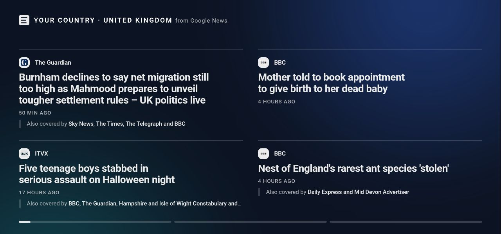
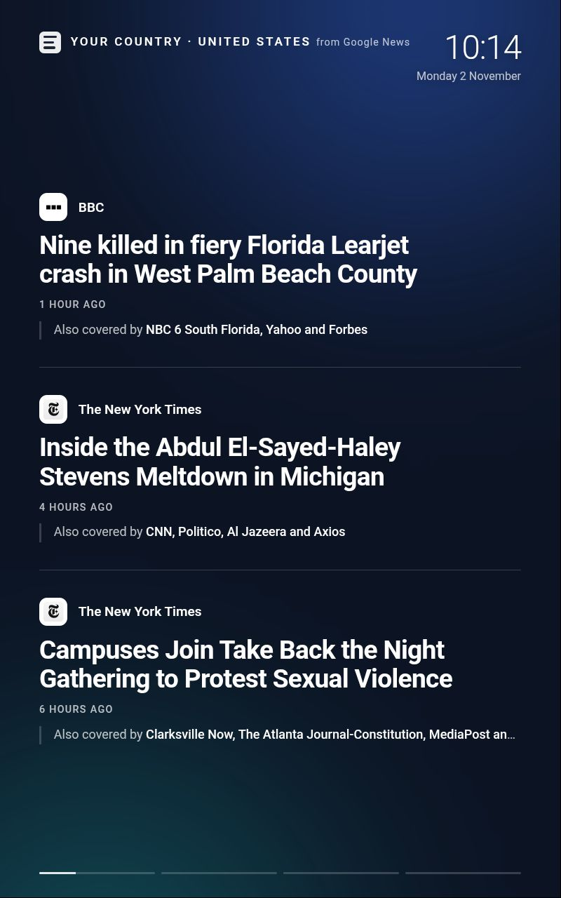

# Google News Headlines

A [Kiosk Satellite](https://kiosksatellite.com) screensaver that cycles through the headlines on [Google News](https://news.google.com). Each story fills the screen with its headline, the outlet that published it and its logo, how long ago it was published and the other outlets covering the same story. Pick the edition, such as United Kingdom or United States, a section, such as World or Sport, or follow a search instead.

This plugin is not affiliated with, endorsed by or sponsored by Google. It reads the public Google News RSS feeds.

## Screenshots





## Installation

### Community Plugins (Recommended)

Google News Headlines is listed in [Community Plugins](https://kiosksatellite.com/plugins/). Use the button below to open it in your Kiosk Satellite and install it.

[](https://kiosksatellite.com/redirect/plugin/?repository=MozKaboom/google-news-screensaver)

Or search for `Google News Headlines` in **Settings > Plugin Manager > Browse plugins** in Kiosk Satellite.

### Manual

1. Open **Settings > Plugin Manager** in Kiosk Satellite and turn on **Enable Plugins**.
2. Choose **Add plugin**, paste `https://github.com/MozKaboom/google-news-screensaver` and choose **Preview**.
3. Review the plugin and choose **Trust and install**.

## Use it

1. Enable **Google News Headlines** from its entry row in Plugin Manager.
2. Open **Screensaver > Screensaver mode** and choose **Headlines (Google News Headlines)**. You can also pick it in a screensaver schedule entry.

Kiosk Satellite still decides when the screensaver starts and stops, its brightness, widgets and pixel shift. The plugin only draws the headlines.

The headlines load when the plugin starts and again on the interval you set. Until the first load finishes the screensaver shows **Loading headlines…**. If Google News can't be reached, it keeps showing the last headlines it loaded and says it's offline. The plugin's subpage shows when the headlines last loaded or why they didn't.

The **Refresh headlines** action loads the latest headlines right away. Run it from the plugin's subpage, a gesture, a drawer shortcut or a Home Assistant button.

## Settings

| Setting | Default | What it does |
| --- | --- | --- |
| Edition | United Kingdom | The Google News edition, which sets the country and language of the headlines. |
| Section | Top stories | Top stories, World, Your country, Business, Technology, Entertainment, Sport, Science or Health. Your country is the edition's national news. |
| Search instead | Empty | The latest stories about a subject, such as a team or a town, instead of a section. Leave it empty to use the section. |
| Number of stories | 10 | How many headlines to cycle through, 3 to 20, in the order Google News lists them. |
| Headlines per screen | 1 | How many headlines to show at once, 1 to 4. More than one stacks them on a portrait screen and puts them side by side on a landscape one. |
| Time per screen | 12 s | How long each screen of headlines stays up. |
| Refresh every | 30 min | How often to load the latest headlines. |
| Show outlet logos | On | Download each outlet's logo from Google. Turn off to show its initial instead. |
| Show other coverage | On | Name the other outlets covering each story, when Google News groups them. |
| Show clock | On | The time and date in the top right corner. |

## Data and privacy

On each refresh the plugin's Java code makes these requests, and no others:

- `https://news.google.com/rss` to read the feed for the edition and section, or the search.
- One request per outlet to Google's favicon service (`encrypted-tbn0.gstatic.com`) for its logo, unless **Show outlet logos** is off. The request names the outlet's website. Logos already loaded aren't downloaded again.

The requests carry no account, cookie or kiosk information beyond what any web browser sends. A search sends its words to Google.

The screensaver page itself makes no network requests. Kiosk Satellite blocks them. The headlines and logos are embedded in the page the plugin publishes.

## Build

Install Python 3, JDK 17 or newer and an Android SDK with a platform and build-tools. Set `ANDROID_HOME` and `JAVA_HOME` as needed.

```sh
python3 tools/test.py
python3 tools/build.py
```

The build creates `dist/google-news-headlines-<version>.zip`. To try it, open **Plugin Manager > Developer Tools > Install from ZIP** in Kiosk Satellite.

Releases are built by the GitHub Actions workflow in `.github/workflows/build.yml` when a release is published.

## License

[Apache-2.0](LICENSE). The SDK interfaces in `sdk/` and the build tools in `tools/` come from the [Kiosk Satellite plugin template](https://github.com/jxlarrea/kiosk-satellite-plugins) under the same license.
